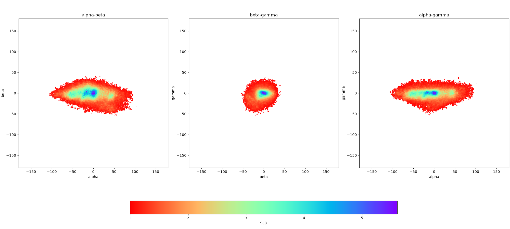
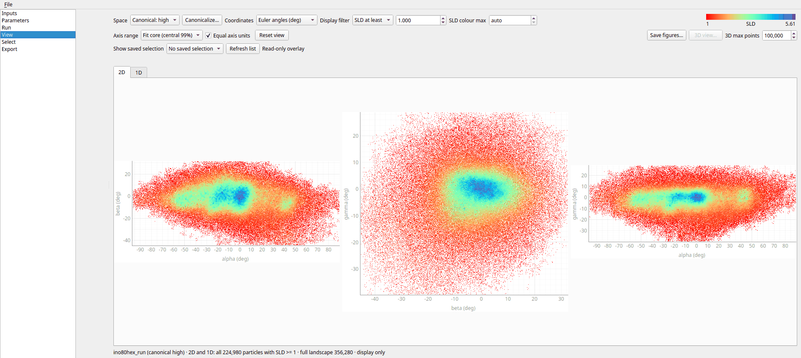
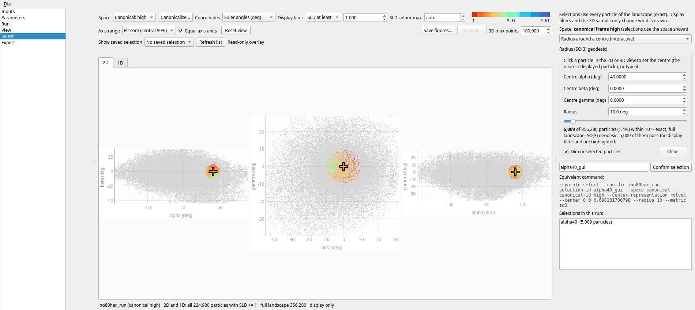

# cryoROLE

[](https://github.com/yifancheng-ucsf/cryorole/actions/workflows/tests.yml)

**cryoROLE (cryo-EM Relative Orientation LandscapE) maps how one domain of a complex rotates relative to another, particle by particle, and lets you export the particles from any region of that landscape.**

You give cryoROLE two pose files from separate focused refinements of the same particles: one for a *reference* domain (`ref`) and one for a *moving* domain (`mov`). For each particle it computes the relative orientation `RO = R_ref⁻¹ R_mov` and a local sampling density (SLD), plots the landscape, and writes the selected particles back out as CryoSPARC `.cs` or RELION `.star` subsets for reconstruction. It does not refine particles or reconstruct maps itself.

Version `2.0.0a1` (pre-release) · CPU only · Linux, macOS, Windows · command line **and** desktop GUI.

[Install](#1-install) · [Demo data](#2-get-the-demo) · [CLI walkthrough](#3-cli-walkthrough) · [Essential parameters](#essential-parameters) · [GUI walkthrough](#4-gui-walkthrough) · [Expected outputs](#5-expected-outputs) · [Your own data](#6-your-own-data)



*The demo landscape (INO80 relative to the hexasome, canonical frame, particles with SLD ≥ 1). Colour = SLD. Made by step 4 below.*

## 1. Install

You need Git and Conda (or any Python ≥ 3.9).

```bash
git clone https://github.com/yifancheng-ucsf/cryorole.git
cd cryorole
conda create -n cryorole python=3.12 -y
conda activate cryorole
python -m pip install ".[gui]"
cryorole --version
```

The last command prints `cryorole 2.0.0a1`. Installation takes about 1–2 minutes. Use `python -m pip install .` without `[gui]` if you only need the command line. On Linux the GUI needs the Qt system library `libxcb-cursor0`. See [Installation](docs/installation.md) for other routes and [GUI notes](docs/gui.md) for platform details.

| Tested with | Versions |
| --- | --- |
| Python | 3.10, 3.11, 3.12 (Ubuntu 24.04, x86-64) |
| Core | numpy 2.5, scipy 1.18, pandas 3.1, matplotlib 3.11 |
| GUI (`[gui]` extra) | PySide6 6.12 (6.11 on Python < 3.12), pyqtgraph 0.14, PyOpenGL 3.1 |
| Optional | UCSF ChimeraX (3D maps, animations), FFmpeg (MP4) |

## 2. Get the demo

The demo is the INO80–hexasome dataset from the cryoROLE paper (raw images: [EMPIAR-13299](https://www.ebi.ac.uk/empiar/EMPIAR-13299/)): **356,280 particles** with poses from two RELION focused refinements of the same particles: the hexasome (`ref`) and INO80 (`mov`). It contains only particle metadata, no images, so it runs on any laptop: about 1.5 minutes of CPU time, 0.7 GB RAM and 0.6 GB disk.

Download `cryorole_demo_ino80_hexasome.zip` (51 MB) from the [v2.0.0a1 release](https://github.com/yifancheng-ucsf/cryorole/releases/tag/v2.0.0a1) (under **Assets**), or from a terminal, and unzip it:

```bash
curl -LO https://github.com/yifancheng-ucsf/cryorole/releases/download/v2.0.0a1/cryorole_demo_ino80_hexasome.zip
unzip cryorole_demo_ino80_hexasome.zip
cd cryorole_demo_ino80_hexasome
```

| File | Content |
| --- | --- |
| `ino80hex_ref_hexasome.star` | hexasome-focused refinement: the **reference** domain |
| `ino80hex_mov_ino80.star` | INO80-focused refinement: the **moving** domain |
| `expected/` | reference run report, quick-look figures and the paper's canonical frame, to compare against |
| `SHA256SUMS` | checksums of every file; check with `sha256sum -c SHA256SUMS` |

Row *N* of the two files is the same particle. The hexasome particles were signal-subtracted and re-centred, so their image names differ from the INO80 file. That is why the commands below use `--row-aligned`.

## 3. CLI walkthrough

Run these commands inside `cryorole_demo_ino80_hexasome/`. Each step reads the run folder `ino80hex_run/` written in step 2.

**Step 1: Check the inputs** (nothing is written).

```bash
cryorole preflight --ref ino80hex_ref_hexasome.star --mov ino80hex_mov_ino80.star --row-aligned
```

Expect `READY` and `Matched 356280 particles; ref coverage 100.0%; mov coverage 100.0%.` `READY_WITH_WARNINGS` means read the warnings before going on. `BLOCKED` means fix the inputs first; preflight prints what to do.

**Step 2: Compute the landscape** (about 35 s).

```bash
cryorole run --ref ino80hex_ref_hexasome.star --mov ino80hex_mov_ino80.star --row-aligned --output-dir ino80hex_run
```

This writes the run bundle `ino80hex_run/`. Open `ino80hex_run/run_report.md` first: it lists the matching, the SLD settings, an RO-angle summary and the quick-look figures.

**Step 3: Express the landscape in a motion-aligned (canonical) frame** (about 35 s; optional for your own data).

```bash
cryorole canonicalize --run-dir ino80hex_run --canonical-id high --fit-top 0.3 --positive-side high --write-csv
```

This fits principal motion axes to the densest 30% of particles and names the frame `high`. With these settings it reproduces the frame of the paper's INO80–hexasome figure (`expected/canonical_high/`). No particles are removed: canonical coordinates are a rotated description of the same landscape.

**Step 4: Plot the landscape.**

```bash
cryorole visualize --run-dir ino80hex_run --space canonical --canonical-id high --representation euler --visual-id demo_sld1
cryorole visualize --run-dir ino80hex_run --space canonical --canonical-id high --representation euler --view 1d --all --visual-id demo_1d
```

The first command writes the three Euler projections above (particles with SLD ≥ 1). The second writes 1D α/β/γ distributions of all particles: α has a main peak at 0° and a shoulder near +40°. In the 2D plot the shoulder is a second dense patch.

**Step 5: Select particles from a region.** Select every particle within 10° (SO(3) rotation distance) of the patch at α ≈ +40°:

```bash
cryorole select --run-dir ino80hex_run --space canonical --canonical-id high --selection-id alpha40 --mode radius --center 40 0 0 --radius 10
```

This prints `selection 'alpha40': 5009 particles`. The centre is in canonical Euler degrees (α β γ). The centre and radius here are for the demo only; for your data, read them off your own landscape.

**Step 6: Export the selected particles.**

```bash
cryorole export --run-dir ino80hex_run --selection-id alpha40
```

This writes `ino80hex_run/exports/alpha40/ref/selected_ref.star` and `mov/selected_mov.star`: the 5,009 selected rows copied unchanged from each input file, with their optics and CTF. Use either file directly in RELION or CryoSPARC for reconstruction or refinement. That step needs the original particle images, which the demo does not include.

### Essential parameters

| Parameter | Command | What it does | Default |
| --- | --- | --- | --- |
| `--ref`, `--mov` | `preflight`, `run` | Pose files (`.cs` or `.star`) of the reference and moving domains. RO is the moving domain's orientation relative to the reference; swapping them asks a different question. | required |
| `--row-aligned` | `preflight`, `run` | Pair row *N* with row *N* instead of matching particle identities. Use **only** when you know the rows correspond (as in the demo). | off: match by CryoSPARC `uid`, or RELION `_rlnTomoParticleName` / `_rlnImageName` |
| `--output-dir` | `run` | New run-bundle folder; later commands read it with `--run-dir`. | `cryorole_outputs` |
| `--sld-metric` | `run` | Distance used for SLD (k-nearest-neighbour density, k = 50). `rotvec_euclidean` is a faster approximation for millions of particles. | `so3_geodesic` |
| `--canonical-id` | `canonicalize`, then `visualize`/`select` | Name of a canonical frame. Downstream commands also need `--space canonical`. | `default` |
| `--fit-top` | `canonicalize` | Fraction of highest-SLD particles used to fit the axes. All particles are kept. | `0.4` |
| `--positive-side` | `canonicalize` | Sign of each axis: toward the `low` or `high` side of the density skew. | `low` |
| `--space` | `visualize`, `select` | `raw` (RO as computed) or `canonical`. Select in the same space you read the centre from. | `raw` |
| `--representation` | `visualize` | `euler` (extrinsic ZYX, degrees), `rotvec` (rotation vector, radians) or `both`. | `both` |
| `--sld-threshold` / `--all` | `visualize` | Show particles with SLD ≥ T / show all. Display only, never changes the data. 2D plots draw at most 100,000 points; `--max-points N` raises that. | SLD ≥ 1 |
| `--selection-id` | `select`, `export` | Name of the saved subset (required for `select`; you choose it). | — |
| `--mode` | `select` | `radius` (`--center A B C` + `--radius DEG`), `threshold` (`--sld-min/--sld-max`), `range`, `random` (`--fraction`, `--seed`) or `metadata`. | `radius` |
| `--domain` | `export` | Export `ref`, `mov` or `both`, in the input's own format. | `both` |

Every command has `--help` with examples. Add `--overwrite` to replace an existing run, frame, selection or export; nothing is overwritten otherwise. See the [CLI reference](docs/cli_reference.md) and [all options](docs/cli_options.md).

## 4. GUI walkthrough

```bash
cryorole gui --run-dir ino80hex_run
```

The window has six pages on the left: **Inputs → Parameters → Run → View → Select → Export**. Every action you confirm also appears as the equivalent `cryorole` command in the **Commands** tab at the bottom.

> The demo needs `--row-aligned`, which the GUI does not offer, so run CLI steps 1–3 first and open the finished run in the GUI as shown above. With your own data, where particle identities match, you can start on **Inputs** instead (see [Your own data](#6-your-own-data)).

1. **View.** Set **Space** to *Canonical: high* and **Coordinates** to *Euler angles (deg)*. With **Display filter** *SLD at least 1*, the status line reads `224,980 particles with SLD >= 1 · full landscape 356,280`. Set the value to 1.5 for 151,990 particles, or choose *All particles*. **Axis range** *Fit core (central 99%)* zooms in on the populated region; it changes only the view. The **1D** tab shows the α/β/γ distributions. **Save figures...** writes the current view as PNGs into the run.

   

2. **Select.** Choose *Radius around a centre (interactive)*. Click a particle in any projection to set the centre, or type it: α = 40, β = 0, γ = 0, **Radius** 10°. The panel reports `5,009 of 356,280 particles (1.4%) within 10°`, the same particles as CLI step 5. Type a name (for example `alpha40_gui`) and click **Confirm selection**.

   

3. **Export.** Pick the selection and *both* domains, keep the suggested output folder (`ino80hex_run/exports/alpha40_gui/`) and click **Export**. The result panel lists `ref/selected_ref.star`, `mov/selected_mov.star` and the next steps for RELION/CryoSPARC.

Selections always use the full landscape. Display filters and the 3D point cap change only what is drawn. **File → Open run...** reopens any run bundle, including ones made on the command line. If OpenGL is not available, the 2D/1D views still work (`cryorole gui --no-gl` skips the 3D check). More in the [GUI guide](docs/gui.md).

## 5. Expected outputs

After the walkthrough, `ino80hex_run/` contains:

```text
ino80hex_run/
  run_report.md                      start here: matching, SLD, RO-angle summary, next steps
  data/raw_landscape.csv | .npz      per-particle RO (Euler + rotation vector), SLD, source rows
  data/match_table.csv               which ref row pairs with which mov row
  visualizations/quicklook/          7 PNGs: all / SLD ≥ 1 / top 40 %, Euler and rotvec, log-SLD histogram
  canonical/high/                    canonical_frame.json, canonical_landscape.csv | .npz
  visualizations/canonical/high/     canonical quick-looks plus demo_sld1/ and demo_1d/ from step 4
  selections/alpha40/                selection.json, selected_particle_keys.csv, summary
  exports/alpha40/ref|mov/           selected_ref.star, selected_mov.star, export reports
```

Check your run against these numbers (and against `expected/`):

| Step | Expected result |
| --- | --- |
| `preflight` | `READY`; 356,280 matched; 100% coverage of both files |
| `run` | `run_report.md`: 356,280 matched, 0 dropped; Euler `extrinsic_zyx`; SLD `so3_geodesic`, k = 50; `RO angle: median 44.5°, 90% 99.3°, 99% 162.9°`; peak memory ≈ 0.6 GB |
| `canonicalize` | `canonical/high/canonical_frame.json` equal to `expected/canonical_high/canonical_frame.json` (to ~1e-15) |
| `visualize` | 224,980 particles with SLD ≥ 1 (151,990 with SLD ≥ 1.5) |
| `select` / `export` | 5,009 particles in `alpha40`; 5,009 rows in each exported STAR file |

Measured on a 24-core Linux workstation: `preflight` 5 s, `run` 35 s, `canonicalize` 35 s, other steps a few seconds each. The quick-look PNGs can differ slightly in appearance between matplotlib versions; the numbers above should not.

## 6. Your own data

Prepare two particle files from separate refinements of the **same particles**, each focused on one approximately rigid domain:

| Software | Use |
| --- | --- |
| CryoSPARC | the particle `.cs` of each refinement (`uid` + `alignments3D/pose`). Keep the job folders: export also writes a `.csg` result group for **Import Result Group**. |
| RELION | the `run_data.star` of each refinement (`_rlnAngleRot/Tilt/Psi` + particle names) |

```bash
cryorole preflight --ref ref_domain.cs --mov mov_domain.cs
cryorole run --ref ref_domain.cs --mov mov_domain.cs --output-dir my_run
cryorole gui --run-dir my_run
```

Or do all of it in the GUI: on **Inputs**, choose each file (**File...**) or refinement job (**Job folder...**). The automatic preflight shows the matched count. On **Parameters**, choose the output folder (choose the SLD metric; k is under Advanced). Then click **Start run** on **Run**.

- Matching uses particle identities, so the two files may be in any order. Do not use `--row-aligned` to force a match: equal row counts do not prove that rows correspond. If signal subtraction or re-extraction changed the RELION names, `preflight` suggests a `cryorole align` command; see the [RELION workflow](docs/relion_workflow.md#preparing-aligned-star-files).
- **Analyses of CryoSPARC `.cs` files made with cryoROLE < 2.0 must be re-run.** `.cs` poses are now read like pyem `csparc2star.py`. RO angles are unchanged but the RO axes differ. RELION inputs are unaffected. See [release notes](docs/release_notes_2_0.md).

**Reading a landscape.** Each point is one particle. The three Euler panels are projections of one 3D rotation distribution, so check all three. SLD is how densely that region of rotation space is sampled. It is *not* particle quality or pose accuracy, and SLD = 1 is not a universal signal/noise boundary. Dense regions are candidates to select and reconstruct. Confirm them with maps, not with SLD alone.

## More documentation

[Quick start](docs/quick_start.md) · [GUI guide](docs/gui.md) · [CLI reference](docs/cli_reference.md) · [All options](docs/cli_options.md) · [CryoSPARC workflow](docs/cryosparc_workflow.md) · [RELION workflow](docs/relion_workflow.md) · [Output files](docs/output_files.md) · [Python API](docs/python_api.md) · [Animation](docs/animation_export.md) · [FAQ](docs/faq.md) · [0.x migration](docs/migration_from_0x.md)

## Citation

If you use cryoROLE, please cite:

- Chengmin Li, Wooyoung Choi, Hao Wu, Yifan Cheng. **CryoROLE: describing large inter-domain rotation in single particle cryo-EM.** bioRxiv, 2026. [doi:10.64898/2026.07.04.736454](https://www.biorxiv.org/content/10.64898/2026.07.04.736454v1)

First application: Wooyoung Choi, Chengmin Li, Yifei Chen, YongQiang Wang, Yifan Cheng. **Structural dynamics of human fatty acid synthase in the condensing cycle.** Nature, 2025. [doi:10.1038/s41586-025-08782-w](https://doi.org/10.1038/s41586-025-08782-w)

## License

[BSD 3-Clause](LICENSE).
